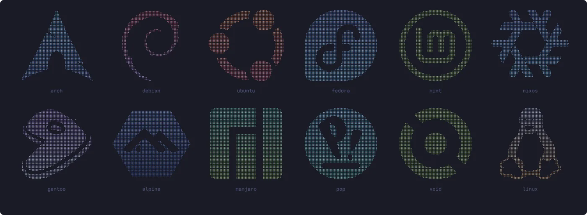

I wrote warpfetch because neofetch took nearly four seconds to open on my openSUSE machine. Almost all of that was `rpm -qa` counting packages, and it ran in every new terminal I opened.

warpfetch reads what it needs straight from `/proc`, `/sys` and `/etc`, so gathering the info takes a few milliseconds. Package databases that are slow to query (rpm, xbps and nix) are counted in the background and cached until they change. The only thing you wait for is the intro, which lasts about a second and can be turned off.

## The intro

Stars streak out from the centre, the field clears, and your distro's logo fades in dot by dot while the info lines appear beside it.

## Logos

The logo is picked from `/etc/os-release`. If your distro isn't one warpfetch knows, it tries the distros listed in `ID_LIKE`, so derivatives get their parent's logo (CachyOS shows Arch, for example). Anything else gets Tux.



There are 23 logos so far, from openSUSE, Arch and Debian to NixOS, Alpine and Void. They're converted from single-colour SVGs by a small script in the repo, `tools/logo2braille.py`, so adding another takes a few minutes.

## What it shows

* OS, host, kernel, uptime, shell, desktop and terminal
* CPU, GPU, memory and disk usage
* Package counts for rpm, dpkg, pacman, apk, portage, xbps and nix, plus Flatpak and Snap

The colours are Tokyo Night, and there's a matching Konsole colour scheme in the repo.

## Install

It needs Rust 1.88 or newer:

```sh
cargo install --git https://github.com/benorrin/warpfetch
```

warpfetch is free software under the GPL v3.
